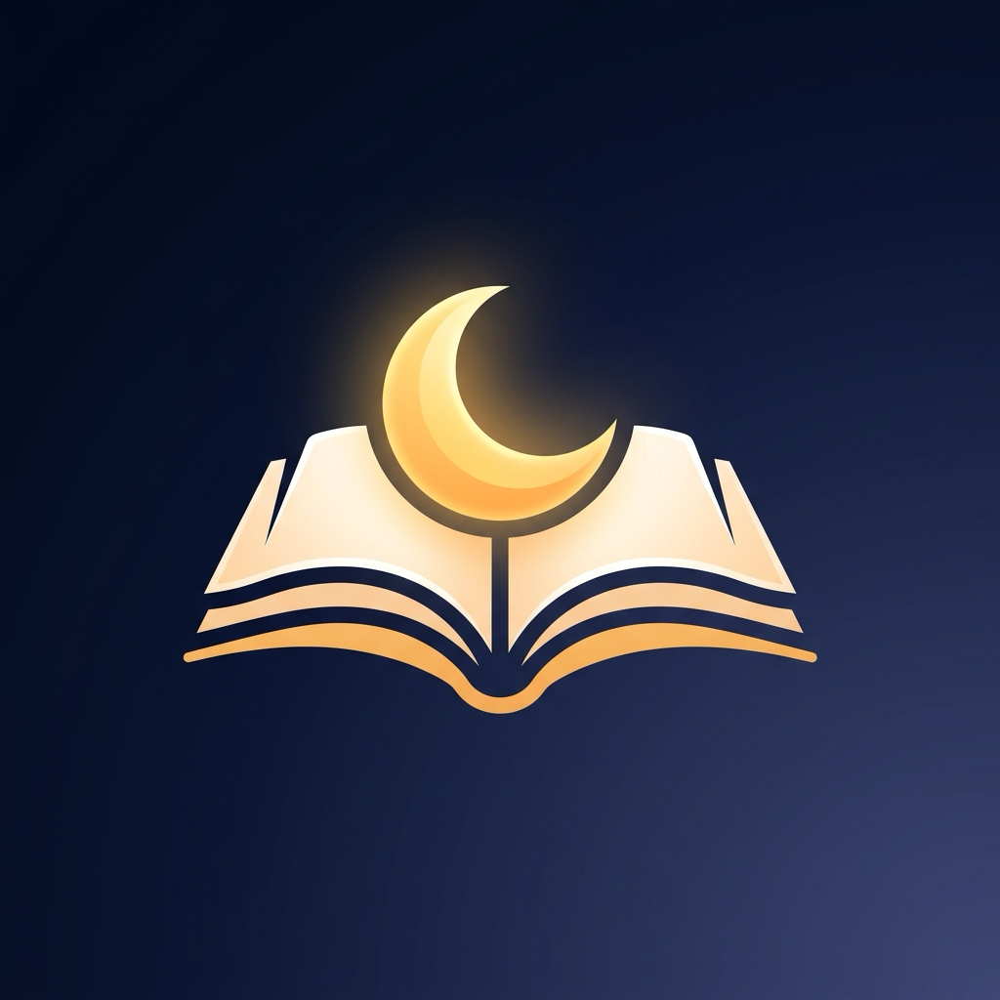

# SnoozeBook · 睡前听书与手势盲听

  
   
  <h3>专为「睡前熄灯好眠」与「视线不便看屏」打造的纯净有声书播放器</h3>
  
<strong>闭眼全屏盲控 · 智能体动入睡守护 · 录音人声增强 · 本地优先隐私保障</strong>

---

## 📖 官方上架与合规文档导航 (Official Links)

- 🔒 **[隐私政策 (Privacy Policy)](PRIVACY_POLICY.md)** *(符合 Apple App Store Review Guideline 5.1)*
- 📜 **[使用条款与最终用户许可协议 (Terms of Use / EULA)](TERMS.md)** *(符合 Apple Guideline 3.1.1)*
- 🛠️ **[技术支持与常见问题解答 (Support & FAQ)](SUPPORT.md)** *(App Store Connect Support URL)*
- 📋 **[App Store Connect 提审全套元数据与审核指引 (App Store Metadata)](APP_STORE_METADATA.md)**

---

## ✨ 核心特色亮点 (Features)

### 1. 📱 全屏盲操手势 (Screen-Free Gestures)
- **熄灯入睡**：彻底告别摸索微小按键，轻触屏幕任意位置即暂停/续播。
- **运动与骑行**：在户外跑步、健身、驾驶与做家务等眼睛不便注视屏幕的场景下，单指左右扫动即可快退/快进 15 秒，上下滑动无缝调节硬件系统音量。

### 2. 🌙 智能入睡守护 (Smart Sleep Detection)
- 结合机身加速度计感知夜间身体静止。
- 达到静止目标时间后音量柔和渐隐 60 秒（轻摇手机即可续播）。
- 确认入睡后自动停播并贴心自动向后回退 2 分钟，确保第二天醒来故事无缝接轨。

### 3. 🕯️ 极暗视觉夜读护眼 (Night Reading Mode)
- 深红夜视 (650nm)、暖琥珀 (590nm)、暗月光三大生物护眼光谱。
- 严格遵循视神经褪黑素保护设计，熄灯环境下丝毫不刺眼。

### 4. 🔊 睡前人声增强与自然伴读音景 (Voice Boost & Ambient Soundscapes)
- 原声、+6dB 增强、+12dB 极强放大，解决老旧磁带与微弱音频录音偏小问题。
- 自带细雨、壁炉、海浪与轻柔慢板钢琴音乐，双轨独立音量混音伴读。

### 5. ⚡ 本地优先与零流量开销 (Local-First Architecture)
- 所有音频均保存在本机沙盒，离线秒开、稳定可靠。
- 支持隔空投送 (AirDrop)、电脑访达 (Finder) 与系统「文件」App 极速导入。
- Pro 会员尊享 iCloud 轻量 Key-Value 进度无缝多端接力。

---

## 🔒 隐私与安全承诺 (Privacy Guarantee)

SnoozeBook 坚守纯粹软件工具的承诺：
- **无账号系统**：无需任何注册、手机号或个人信息。
- **零追踪**：严禁集成任何第三方广告 SDK 或用户行为分析代码。
- **传感器数据瞬态计算**：睡眠检测仅在内存中短时运算，绝不落盘、绝不上传。
- **一次性买断**：拒绝周期订阅陷阱，一次买断，终身可用。

---

## 📬 技术支持与意见反馈 (Contact & Support)

如在使用过程中遇到任何问题或建议，欢迎访问 [GitHub Issues](https://github.com/kinson5/SnoozeBook/issues) 提交工单。
